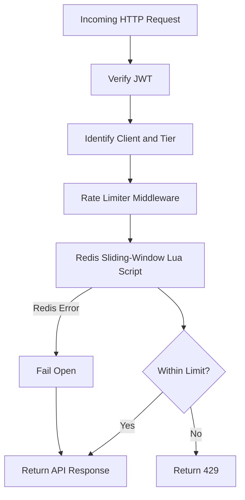

# Bouncer API

Bouncer is a backend rate-limiting API built with Node.js, Express, and Redis. It controls how frequently a client can send requests within a rolling time window.

The project is designed to protect API availability, enforce different request limits for different user tiers, and remain available when Redis temporarily fails.

## Features

- Sliding-window rate limiting using Redis sorted sets.
- Atomic rate-limit operations implemented with a Redis Lua script.
- Client identification using IP addresses for guests and verified JWT identities for authenticated users.
- Guest, free, and premium rate-limit tiers.
- Rate-limit response headers and `429 Too Many Requests` responses.
- JWT validation for authenticated clients.
- Configurable limits and time windows through environment variables.
- Fail-open behaviour when Redis rate-limit checks fail.
- Automated tests covering rate limiting, authentication, concurrency, expiry, and Redis failure handling.

## Technology Stack

- Node.js (ES modules)
- Express
- Redis
- Docker Compose
- JSON Web Tokens (`jsonwebtoken`)
- Supertest and Node.js built-in test runner

## Requirements

Install the following before running the project:

- Node.js and npm
- Docker Desktop with Docker Compose

## Getting Started

### 1. Clone the repository

```bash
git clone https://github.com/Elias768-collab/Bouncer.git
cd Bouncer
```

### 2. Install dependencies

```bash
npm install
```

### 3. Configure environment variables

Create your local environment file:

```bash
cp .env.example .env
```

Edit `.env` and configure the following variables:

```dotenv
REDIS_URL=redis://localhost:6379/0
JWT_SECRET=replace_with_a_long_random_secret

GUEST_RATE_LIMIT=10
GUEST_RATE_WINDOW_SECONDS=60

FREE_RATE_LIMIT=15
FREE_RATE_WINDOW_SECONDS=60

PREMIUM_RATE_LIMIT=25
PREMIUM_RATE_WINDOW_SECONDS=60
```

`REDIS_URL` points to your Redis instance. `JWT_SECRET` is used to verify authenticated users' tokens. Replace the example secret with a strong, private value.

All rate-limit and window values must be positive integers. If a value is omitted or left blank, Bouncer uses its default.

**Never commit your `.env` file or real secrets to GitHub.**

### 4. Start Redis

From the project root, run:

```bash
docker compose up -d
```

Check that the Redis container is running:

```bash
docker ps
```

### 5. Start Bouncer

For normal use:

```bash
npm start
```

For development with automatic restarts:

```bash
npm run dev
```

The API listens on port `4000` by default. You can override this using the `PORT` environment variable.

### 6. Send a test request

The main endpoint is `GET /`.

```bash
curl -i http://localhost:4000/
```

Requests without an authorization token are treated as guests and use the guest rate limit.

## Authentication

Bouncer accepts JWTs in the following format:

```http
Authorization: Bearer YOUR_JWT_TOKEN
```

A valid token must be signed using the configured `JWT_SECRET` with the HS256 algorithm. It must include:

- `sub`: a non-empty user identifier.
- `tier`: either `free` or `premium`.
- `exp`: a numeric expiration timestamp.

For example, a token's decoded payload could look like this:

```json
{
  "sub": "user-123",
  "tier": "free",
  "exp": 1893456000
}
```

This is an illustrative payload, not a valid signed token by itself.

Invalid or expired tokens receive `401 Unauthorized`. Requests without a token continue as guests.

## Rate Limits

The default limits are:

| Client tier | Maximum requests | Window |
|---|---:|---:|
| Guest | 10 | 60 seconds |
| Free | 15 | 60 seconds |
| Premium | 25 | 60 seconds |

The window is rolling: Bouncer tracks request timestamps and removes expired entries as new requests arrive.

The limits and window sizes can be changed through the environment variables described above.

## Response Headers

Successful requests include these rate-limit headers:

| Header | Purpose |
|---|---|
| `X-RateLimit-Limit` | Maximum requests allowed in the window |
| `X-RateLimit-Remaining` | Requests remaining in the current window |
| `X-RateLimit-Reset` | Unix timestamp when the oldest tracked request expires |

When a client exceeds its limit, Bouncer responds with `429 Too Many Requests` and includes a `Retry-After` header.

## Failure Handling

Bouncer follows a **fail-open** policy when Redis rate-limit checks fail.

If Redis becomes unavailable, Bouncer allows the request to continue instead of allowing a Redis outage to make the API unavailable.

This improves availability but has a trade-off: requests may temporarily bypass rate limiting while Redis is unavailable. Rate-limit headers may also be absent during that period.

The Redis client attempts to reconnect, and normal rate-limit enforcement resumes when Redis becomes available again.

## Architecture



The request passes through authentication and client identification before the rate limiter checks the client's request history. The Redis Lua script performs the sliding-window operation atomically to avoid concurrent requests bypassing the limit.

## Running Tests

Make sure Redis is running, then run:

```bash
REDIS_URL=redis://localhost:6379/1 npm test
```

The test suite uses Redis database `1` to isolate test data from the default development database.

Tests cover:

- Guest rate-limit headers and enforcement.
- Invalid and expired JWTs.
- Free and premium tier limits.
- Concurrent requests.
- Sliding-window expiry.
- Fail-open handling when a rate-limit check fails.

## Project Structure

```text
bouncer/
├── src/
│   ├── algorithms/
│   ├── config/
│   ├── middleware/
│   ├── redis/
│   ├── scripts/
│   ├── utils/
│   └── app.js
├── test/
│   └── app.test.js
├── server.js
├── docker-compose.yml
├── documentation.md
├── changelog.md
├── .env.example
└── package.json
```

## Current Status

Bouncer's core rate-limiting functionality, tier configuration, JWT verification, automated tests, and Redis fail-open behaviour have been implemented and tested locally.

Deployment and any remaining production-readiness checks should be verified separately before treating the service as production-ready.